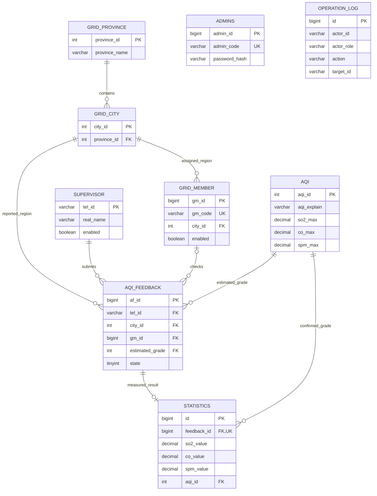

# 数据库设计

数据库名 environment_system，MySQL 8.4 / InnoDB / utf8mb4。具体列类型、默认值、索引和约束以 sql/schema.sql 为准。



## 表与关键字段

| 表 | 关键字段 | 说明 |
| --- | --- | --- |
| admins | admin_id, admin_code, password_hash, real_name | 管理员登录账号唯一 |
| supervisor | tel_id, real_name, birthday, sex, enabled, password_hash | 手机号主键；性别0女1男 |
| grid_member | gm_id, gm_code, gm_name, tel, province_id, city_id, enabled | 所属省市必须对应；登录账号唯一 |
| grid_province | province_id, province_name, province_abbr | 演示省级字典 |
| grid_city | city_id, province_id, city_name | 与province_id构成复合唯一键，用于校验省市归属 |
| aqi | aqi_id, color, health_impact, so2_max, co_max, spm_max | 6级；最高等级上限为NULL表示无上界 |
| aqi_feedback | af_id, tel_id, city_id, address, information, estimated_grade, gm_id, state | 状态0待指派、1待实测、2已完成 |
| statistics | feedback_id, 三项value, 三项level, aqi_id, confirmed_at | 每条反馈最多一条实测记录 |
| operation_log | actor_id, actor_name, actor_role, action, target_id, result | AOP生成的业务写入日志，不保存密码 |

所有表均有 created_at、updated_at。反馈另外记录 submitted_at、assigned_at、confirmed_at，便于追踪流程。业务身份从Session取得，时间由后端或数据库生成。

## 分级规则

| 等级 | 名称 | SO₂上限 μg/m³ | CO上限 mg/m³ | PM2.5上限 μg/m³ |
| --- | --- | --- | --- | --- |
| 1 | 优 | 50 | 5 | 35 |
| 2 | 良 | 150 | 10 | 75 |
| 3 | 轻度污染 | 475 | 35 | 115 |
| 4 | 中度污染 | 800 | 60 | 150 |
| 5 | 重度污染 | 1600 | 90 | 250 |
| 6 | 严重污染 | 无上界 | 无上界 | 无上界 |

取首个“浓度小于等于上限”的等级；六级承接所有更大非负值。三个等级取最大值。该表保留教材简化分级口径，不代表完整现行国标AQI计算。

## 事务与数据一致性

- 指派先锁定反馈，再锁定目标网格员，检查状态、城市及可用性。
- 修改网格员时锁定该人员，存在待实测任务时禁止停用或更换城市。
- 实测先锁定反馈，验证所属网格员和状态，再插入唯一实测记录、更新反馈、记录操作日志。
- 业务事务在AOP日志外层；日志失败会使该次业务修改回滚。
- 人员历史记录通过停用保留，不提供物理删除。
- 日常应用启动不自动执行DDL或种子脚本。
- 初始化器在一个事务内产生账号、字典和业务演示记录；重复执行拒绝覆盖。

## 常用核对 SQL

```sql
SELECT state, COUNT(*) FROM aqi_feedback GROUP BY state;
SELECT COUNT(*) FROM statistics;
SELECT f.af_id FROM aqi_feedback f
LEFT JOIN statistics s ON s.feedback_id=f.af_id
WHERE (f.state=2 AND s.id IS NULL) OR (f.state<>2 AND s.id IS NOT NULL);
-- 上面的不一致查询应返回0条。
SELECT action, COUNT(*) FROM operation_log GROUP BY action;
```
