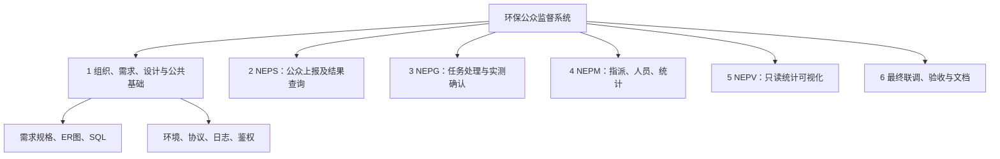
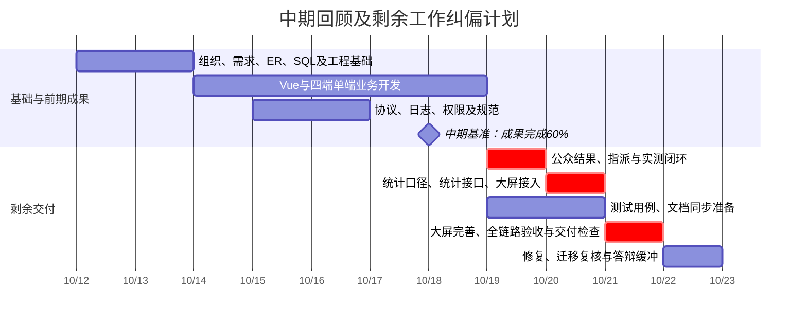

# 环保公众监督系统项目绩效报告

**评审主题：范围、进度的状态、状况与预测**  
**项目成员：A、B、C、D**  
**报告基准日：2026年10月18日；课程截止日：2026年10月22日**  
**阶段完成度：3/5，即60%**

> 编制口径：本报告依据老师的《notes(3).md》、本项目四端业务范围，以及小组指定的“完成3/5”编制，属于中期评审稿。现有项目完整版本可供参考，但本报告只将下列约定的阶段成果计入中期完成量，不把完整版本的最终验收结论提前计入。200人时预算、128人时实际投入和各项完成量是用于建立合理计划的估算，尚非成员工时记录或老师签字认可的结果；正式提交前应以任务记录、提交记录和阶段评审结果核实。报告中的“阶段完成”表示满足本阶段检查条件，不等于最终验收通过。

## 一、项目概况与绩效结论

本项目面向环保公众监督业务，建设公众监督员端NEPS、AQI检测网格员端NEPG、系统管理端NEPM和可视化大屏端NEPV。四端共同支撑“公众上报空气质量问题—管理员指派—网格员现场实测并确认—管理端汇总统计—大屏展示”的业务闭环。

系统采用Spring Boot、Vue、MySQL和Node构建工具。NEPS、NEPG采用适配手机的Vue网页，NEPM、NEPV面向PC浏览器。NEPG本期采用人工录入检测数据，NEPV采用定时刷新。传感器接入、Qt原生应用、微信平台发布和复杂预测分析不纳入本期基线。

截至本报告基准日，按工作量加权完成120/200人时对应的交付成果，整体完成度为60%。需求、数据库、开发基础与老师已布置的公共技术任务列入本阶段完成范围；公众端和网格员端已具备主要单端业务，管理端指派和统计、大屏数据联动及最终验收仍需继续推进。

**范围状态为基本受控，进度状态为轻度滞后，按期交付预测为有条件可达。** 本阶段计划完成70%，实际完成60%，差距为10个百分点，对应20计划人时的成果，约相当于基准安排下1个小组工作日。通过冻结新增需求、优先贯通业务闭环、调整协作，并在10月19日至21日安排每人每日7.5小时，预计可以在10月21日完成交付检查，10月22日保留用于问题修复和答辩准备。

## 二、范围绩效

### 2.1 范围基线与四端分工

| 成员 | 唯一主责模块 | 本期必须交付的业务 | 完成判定 |
| --- | --- | --- | --- |
| A | NEPS公众监督员端 | 注册登录、反馈提交、省市选择、本人记录查询、状态及实测结果查看、手机适配 | 公众能提交有效反馈，并查看本人反馈从待指派到完成的结果；不能查看他人私有记录 |
| B | NEPG网格员端 | 登录、本人任务查询、详情查看、SO₂/CO/PM2.5实测录入、等级确认、任务状态更新、手机适配 | 网格员只能处理本人任务；合法数据可提交并更新状态；重复提交和非法数据被拒绝 |
| C | NEPM系统管理端 | 管理员登录、反馈筛选与指派、监督员管理、网格员管理、统计汇总、日志查询 | 能将任务指派给符合区域条件的网格员；统计与有效实测数据一致；业务写入可追溯 |
| D | NEPV可视化大屏端 | 指标卡、等级分布、地区统计、趋势图、定时刷新、只读展示、PC适配 | 图表接入统计接口并显示真实业务汇总；刷新后能反映新增数据；展示接口不泄露个人信息 |

执行RACI的“一项成果只有一个最终负责人”：每端分别由对应成员对结果负责，其他成员可参与协作或评审。数据库、公共协议、鉴权、日志等共享成果另行指定唯一负责人，避免四人各做一套。

组长姓名尚未提供，本稿建议由C兼任集成协调人，负责接口变更登记和进度汇总；这不代表已经完成组长推举。正式提交时应填写真实推举结果。各成员先自审，再进行交叉评审：A与B互审移动业务，C与D互审统计与展示。

### 2.2 工作分解结构及完成量

下表预算为各工作包在正常条件下需要的计划人时。完成量只计算达到阶段检查条件的成果；模块内部按已完成的子任务累计，不以代码行数或页面数量直接估算。

| WBS | 工作包 | 预算BAC/人时 | 计入完成量EV/人时 | 完成比例 | 本阶段已计入的成果 | 尚未计入的成果 |
| --- | --- | ---: | ---: | ---: | --- | --- |
| 1 | 组织、需求、设计与公共基础 | 40 | 40 | 100% | 需求分解、学习任务分工、ER与SQL、环境与分层框架、协议、日志及鉴权基础；组织项须补真实组长记录 | 公共能力的跨端异常回归随最终测试完成 |
| 2 | NEPS公众监督员端 | 35 | 28 | 80% | 登录注册、反馈表单、本人列表与详情、基础移动适配 | 完成结果回显的跨端联调、异常提示、移动设备回归 |
| 3 | NEPG网格员端 | 40 | 24 | 60% | 登录、本人任务列表与详情、实测录入界面及基础校验 | 浓度等级边界、重复提交防护的联调、提交后状态同步与回归 |
| 4 | NEPM系统管理端 | 45 | 23 | 51.1% | 登录权限、反馈查询、指派与人员管理基础功能 | 指派到接单的联调、人员状态约束完善、统计口径及接口验证 |
| 5 | NEPV可视化大屏端 | 25 | 5 | 20% | 布局与图表组件、展示指标定义、接口字段约定 | 接入真实汇总数据、定时刷新、空数据与断网处理、PC展示校验 |
| 6 | 最终联调、验收与交付文档 | 15 | 0 | 0% | 已有早期测试规划和文档草稿，计入WBS1，不在此重复计量 | 全链路和权限回归、部署迁移、README定稿、演示与验收记录 |
| 合计 | 项目交付基线 | **200** | **120** | **60%** | | |

WBS1按40人时计满是本稿的阶段设定，前提是需求、ER、SQL和公共基础均通过检查，组织记录也已补齐。若核查发现缺项，应将缺项对应的完成量扣回，并重新计算整体完成度；不能为了维持60%而把未完成任务计为完成。

### 2.3 老师已布置任务与阶段成果的对应

| notes中的任务及时间 | 本阶段应完成的内容 | 建议负责人 | 检查或证明方式 |
| --- | --- | --- | --- |
| 10月12日：分组、推举组长、分配学习任务 | 明确四端责任和协作机制，登记真实组长；A学习公众表单，B学习实测与等级计算，C学习指派与事务，D学习ECharts及刷新 | C协调，全员确认 | 分工表、组长记录、学习任务清单；缺少组长记录须补齐 |
| 10月12日：每位成员具备完整开发环境 | Java17、Spring Boot/Maven、MySQL、Node和Vue工程可运行；每位成员均能启动并连接数据库 | A统筹，各自验证 | 四人的启动记录、数据库连接记录；开发工具差异在评审中说明 |
| 10月12日：至少10条需求规格 | 明确前置条件、输入、处理、输出、验收点，覆盖四端 | A主责，全员评审 | 本报告附录的12条需求检查稿；需与实际版本逐条核对 |
| 10月12日：ER图与SQL | 完成监督员、网格员、管理员、省、市、等级、反馈、实测八类核心表；增加业务操作日志表 | B主责 | 项目docs/DATABASE.md、sql/schema.sql和sql/seed.sql；检查外键、时间字段、执行顺序及初始化 |
| 后端基础教学：分层、映射、接口测试 | 建立数据模型、Mapper、Service、Controller；简单查询使用注解，复杂关联使用XML | B主责，C协作 | 分层代码、Mapper/XML对应关系、可重复的接口测试记录 |
| 10月14日前后：Vue项目、路由、数据绑定与组件 | 四端完成Vue工程与页面骨架，配置路由、表单绑定、请求和响应渲染 | D主责，各端配合 | 四端基础页面可访问；移动端与PC端分别检查 |
| 10月15日：定义协议、推荐RESTful | 统一请求和响应格式、分页和错误处理，统一资源路径及HTTP方法 | C主责 | docs/API.md，响应为code/message/data，错误场景有对应HTTP状态 |
| 10月15日：查询外的数据操作记录日志 | 在公共基础中实现业务增改操作的AOP审计，记录操作人、时间、动作与目标 | C主责 | 抽查新增反馈、指派、提交实测、人员修改的日志；失败事务不留下成功业务结果 |
| 10月16日：规范Service方法名 | 方法名表达查询、创建、修改等业务动作，明确审计匹配范围，避免漏记和重复记 | C主责 | 方法清单与审计规则核对；本项目使用明确审计标记，与规范命名配合 |
| 10月16日：确定数据访问方式 | 统一简单查询用注解、复杂联查用XML的约定，避免四端各自改变规则 | B主责 | 数据访问约定、典型接口样例和对应SQL |
| 10月16日：拦截器、过滤器、跨域白名单 | 登录与角色拦截、本人数据校验、UTF-8编码；明确公共路径白名单和请求来源规则 | C主责，B协查 | 白名单清单，检查未登录、越权、非法来源和中文数据；如无独立过滤器需求，说明由框架配置承担的功能 |
| 中期评审：WBS、时标网络与甘特图、绩效 | 说明范围边界、依赖、估算、状态、原因、措施和预测 | C汇总，全员确认 | 本报告的WBS、进度表、网络图、甘特图及绩效计算 |

上述课程任务必须包含在本阶段工作中，不能整体推迟到最后40%。课堂示例中的删除重建SQL只适用于明确隔离的初始化或演练；现有业务数据的日常启动不执行清库。Vue是本期前端共同实现方式；Qt、传感器和WebSocket在notes中属于建议或例子，本期不将其扩展成必交项。

环境方面，本项目先前已采用VS Code和便携运行环境。notes提到IDEA，因此正式汇报时应说明这一工具差异，并核实教师是否要求统一IDE。代码构建与运行能力不能代替“每位成员均配置成功”的证明，两者应分别核查。

### 2.4 范围状况分析与控制措施

前一阶段的范围管理重点是把“完成四个端”的抽象要求，拆分为可检查的业务成果。较明确的成果是用户角色、核心数据对象、反馈状态和接口协议；难点主要集中在跨端边界：公众提交后何时可见、什么人员可以接单、实测提交后怎样改变状态，以及统计是否包含尚未确认的反馈。

针对这些边界，后续统一采用“待指派—待实测—已完成”三种反馈状态。指派必须满足人员启用和区域条件；网格员只处理本人任务；统计按已经确认的实测记录计算，未确认反馈可单列为待处理数量，但不混入实测空气质量分布。

范围控制采取以下规则：

1. 四端共用一套身份、地区、等级和统计口径，公共能力只建设一次。
2. 必须覆盖公众上报、指派、实测、结果查询和统计展示；页面美化不能替代业务闭环。
3. 对需求清单之外的功能，先登记目的、工作量及对截止日期的影响，再决定是否进入后续版本。
4. 文档、数据库、接口和页面保持一致；每次接口变化由接口负责人同步API文档，并通知调用方。
5. 将需求、实现和验收点建立对应关系，验收以有效业务结果为准，不能仅凭“页面已经画好”认定完成。

### 2.5 范围预测

剩余40%的范围集中在跨端联调、统计与大屏、异常规则和交付检查，预计无需增加新的业务模块。只要保持范围冻结，四端最小完整交付范围能够覆盖课程要求。

若临时增加传感器硬件、原生APP、地图平台、消息推送或复杂分析，需要新增协议适配、环境配置和测试，现有剩余工时无法直接吸收，应另列后续版本。若发现遗漏的是老师明确要求的任务，则应将其作为基线缺项处理，先完成必要功能，再压缩装饰性工作，不能按“新增功能”直接排除。

## 三、进度绩效

### 3.1 计划基线与估算方法

以10月12日至21日为10天实施窗口，10月22日为交付与缓冲日。课程实训期间周末是否投入需由小组确认，本稿按该窗口每天均可投入计算。

基准投入为4人×5小时/日×10日，共200计划人时；10月22日另保留4人×5小时，共20人时应急能力，相当于基准工作量的10%。缓冲不预先计入正常功能开发预算，也不计入完成度分母。工作量估算依据任务分解和小组讨论，按人时衡量，不代表现金成本。

基础分工的200人时按下表安排。四人的预算各50人时，公共任务与文档承担量不同，不能仅比较模块开发人时判断贡献。

| 成员 | 公共基础 | 主责端 | 最终联调与文档 | 合计 |
| --- | ---: | ---: | ---: | ---: |
| A | 10 | 35 | 5 | 50 |
| B | 6 | 40 | 4 | 50 |
| C | 2 | 45 | 3 | 50 |
| D | 22 | 25 | 3 | 50 |
| 合计 | 40 | 145 | 15 | 200 |

D的公共基础投入包含页面公共布局、Vue工程、路由与组件约定、需求及图表口径协作，因此大屏接入仅完成20%不等于D只完成了少量工作。C负责协调和审核共享成果，不表示所有公共工作均由C独立编写。

### 3.2 基准计划与本期状况

| 时间 | 基准计划 | 计划成果增量/人时 | 截至本期的情况 |
| --- | --- | ---: | --- |
| 10月12日 | 分组、环境、需求、ER与SQL初稿 | 20 | 按阶段口径纳入公共基础；组织与环境证明需核实 |
| 10月13日 | 数据库、分层工程和映射、接口基础 | 20 | 公共基础列入完成，后续持续回归 |
| 10月14日 | 四端Vue骨架、路由、表单与基础页面 | 20 | 已形成页面与单端开发基础 |
| 10月15日 | 统一协议、RESTful接口、AOP日志及业务开发 | 20 | 公共协议与日志基础纳入完成 |
| 10月16日 | Service规范、数据访问约定、权限与来源白名单 | 20 | 公共规范纳入完成，跨端异常验证仍待深化 |
| 10月17日 | 单端业务完善、第一轮跨端联调 | 20 | 部分成果未达到联调检查条件 |
| 10月18日 | 指派、实测、统计衔接，达到累计70% | 20 | 实际阶段完成60%，累计少完成20计划人时成果 |
| 10月19日 | 业务闭环与统计推进 | 20 | 需按纠偏计划提高可用投入并重新排序 |
| 10月20日 | 统计、大屏、回归推进 | 20 | 需优先完成数据口径及真实数据接入 |
| 10月21日 | 全链路验收、交付资料和演示 | 20 | 目标保持，预估投入需增加 |
| 10月22日 | 问题修复、迁移复核和答辩缓冲 | 额外预留20 | 原则上不安排新增功能 |

截至10月18日，计划值PV为140人时，完成成果对应的挣值EV为120人时，实际投入AC暂估128人时。60%是成果完成比例，不能据此直接认定进度正常；必须与同一时点的计划70%比较。

### 3.3 当前状态的量化评价

| 指标 | 计算 | 数值 | 解释 |
| --- | --- | ---: | --- |
| BAC，总计划工作量 | WBS预算合计 | 200人时 | 正常交付基线，不含20人时缓冲 |
| PV，计划值 | 截至10月18日计划完成量 | 140人时 | 计划完成70% |
| EV，挣值 | 阶段检查通过成果的预算量 | 120人时 | 实际成果完成60% |
| AC，实际投入 | 暂估已投入工时 | 128人时 | 待四人实际记录核实 |
| SV，进度偏差 | EV−PV | −20人时 | 少完成20计划人时成果，轻度滞后 |
| SPI，进度绩效指数 | EV÷PV | 0.857 | 计划完成1份成果，目前实际完成约0.857份 |
| CV，工时偏差 | EV−AC | −8人时 | 为120计划人时的成果投入128人时，效率低于估算 |
| CPI，工时绩效指数 | EV÷AC | 0.9375 | 每投入1人时，形成约0.9375计划人时的成果 |

这里的CV与CPI是人时口径的投入效率参考，不是财务支出或工资成本；SPI也不能不考虑人员并行和任务依赖，机械地换算成最终延期天数。

### 3.4 前一阶段的状况、原因及纠偏

以下为结合任务依赖作出的原因分析假设，需在组会中用任务记录验证。

| 表现 | 可能原因 | 影响 | 处理措施 | 主责 |
| --- | --- | --- | --- | --- |
| 单端页面较快，跨端数据流较慢 | 前期按端开发，状态、身份、错误码理解未完全统一 | 提交、指派、实测之间反复调整 | 冻结字段及状态约定，逐步验收一条完整业务样例 | C |
| 网格员实测确认尚未计满 | 等级边界、重复提交和权限异常需要前后端共同验证 | 结果不稳定时不能作为统计输入 | B与C共同核对后端规则，完成边界与重复请求检查 | B |
| 管理端承担指派、人员和统计多条任务 | 依赖多、接口集中，负责人容易成为瓶颈 | 大屏等待数据，最终联调延后 | A完成公众端后协助C做4计划人时的接口样例和回归 | C |
| 大屏布局先于真实数据接入 | 统计接口及计算口径完成较晚 | 图表看似完成，但缺少有效业务证明 | 先固定接口样例，再接真实数据，最后美化 | D |
| 总投入大于已完成成果预算 | 环境适配、接口返工及联调等待 | CPI小于1，剩余工时增加 | 共享环境脚本、短周期核查、减少重复搭建 | C协调 |

质量检查按PDCA执行：每天先明确当天交付和用例，开发后自测，交叉检查，再将问题纳入次日清单。10月19日闭环通过后再扩大统计验证范围，避免不稳定的原始数据传播到图表。

### 3.5 任务依赖与关键路径

主要依赖为：需求和数据库 → 协议与公共基础 → 公众反馈 → 管理指派 → 网格员实测 → 统计汇总 → 大屏真实数据展示 → 全链路验收。页面骨架、测试用例、文档可以并行准备；最终统计正确性必须等待有效实测结果。

纠偏后的时标安排如下。甘特图中的开发条表示实施窗口，不能直接当作各模块的工作量占比；同一天可以安排并行任务。

## 四、剩余工作与完工预测

### 4.1 尚需投入与完工估算

保持目前投入效率时：

\[
ETC=(BAC-EV)/CPI=(200-120)/0.9375\approx85.33\text{人时}
\]

\[
EAC=AC+ETC=128+85.33\approx213.33\text{人时}
\]

因此，剩余成果的预算量是80人时，但按目前效率预计需要再投入85.33人时；两者不是同一个指标。预计总投入较200人时基线增加13.33人时，约6.7%，仍低于包含20人时缓冲的220人时资源上限。这个结论仅表示总资源可能覆盖，能否按时完成仍取决于这些工时是否能及时安排到关键任务上。

### 4.2 时间可行性与资源调整

若仍按每人每天5小时，10月19日至21日只有60人时正常能力，少于85.33人时预测需求。即使耗尽10月22日的20人时缓冲，合计80人时仍不足，且没有修复余量。因此，保持原投入方式时按期交付存在明显风险。

建议在不增加成员的前提下，10月19日至21日将可用投入调整为每人每天7.5小时，3天共90人时；相对85.33人时预测需求，约有4.67人时内部余量，并保留10月22日的20人时应急窗口。该调整需要四名成员确认真实可用时间，不能将暂定安排写成已经投入。

| 日期 | 当天优先成果 | 剩余成果的预算量 | 按当前CPI预测投入 | 当日完成门槛 |
| --- | --- | ---: | ---: | --- |
| 10月19日 | NEPS剩余7、NEPG剩余16、NEPM指派联调5 | 28人时 | 约29.87人时 | 一条反馈完成上报、指派、实测及结果回显；异常提交和越权访问被拒绝 |
| 10月20日 | NEPM统计剩余17、NEPV真实数据接入10 | 27人时 | 28.80人时 | 统计结果与数据库抽样一致；大屏接入同一统计口径并能刷新 |
| 10月21日 | NEPV完善10、最终测试与文档15 | 25人时 | 约26.67人时 | 业务、权限、设备适配和部署检查完成；README及演示材料定稿 |
| 10月22日 | 已知缺陷修复、迁移复核与答辩 | 不预排新功能 | 预留20人时 | 无阻断交付的问题，修复后完成针对性回归 |

每日预测投入因四舍五入合计为85.34人时，未四舍五入合计为85.33人时。

人员上，原剩余预算分布为A12、B20、C25、D23人时。安排A协助C的接口回归4人时、协助D的数据与展示验证3人时后，剩余执行量调整为A19、B20、C21、D20计划人时。按当前效率分别预计投入20.27、21.33、22.40、21.33人时，均不超过3天每人22.5小时的安排。C和D仍对自己的模块成果负责，协助不改变唯一主责关系。

### 4.3 情景预测与触发条件

| 情景 | 条件 | 预测 | 应对 |
| --- | --- | --- | --- |
| 基准纠偏情景 | 每人每日7.5小时落实，接口冻结，CPI约0.9375，无重大缺陷 | 10月21日完成主要验收，22日保留修复窗口 | 每日晚间核对成果和实际工时 |
| 效率改善情景 | 公共规范稳定，剩余CPI提高至1 | 余下约需80人时，总投入约208人时 | 将节余时间用于异常与迁移验证 |
| 效率下降情景 | 剩余CPI降至0.8 | 余下需100人时，21日前能力不足，需动用22日缓冲 | 立即调整协作，压缩装饰性工作，集中处理关键依赖 |
| 资源不足情景 | 无法增加投入，仍每日每人5小时 | 截至22日剩余能力80人时，低于85.33人时预测需求 | 立即向教师汇报资源与进度偏差，协商支持或调整交付安排，不隐瞒延期风险 |

关键检查点：10月19日结束前闭环未贯通，或20日结束前统计接口仍无法稳定供数，均应将进度风险提高并重新估算。若21日晚仍有登录失败、无法指派、实测不能保存、统计明显错误或越权访问等阻断问题，22日只处理这些问题和相关回归，不安排美化与新增需求。

## 五、阶段评审意见

从范围看，本阶段已明确四端边界、核心数据库和公共技术规则，老师此前布置的需求、ER图、SQL、协议、日志、Service规范及白名单等任务应在本阶段交付，覆盖方向符合课程要求。正式认定完成前，还需补齐真实组长、四人环境验证和工时记录，并按成果检查表确认。

从进度看，完成3/5说明项目已有主要基础和部分业务成果，但相对于10月18日应达到的70%基准，仍少完成10个百分点。剩余工作集中在依赖较多的闭环联调、统计、大屏及验收，不能简单按“页面还剩40%”估计难度。

建议中期评审结论为：**允许按纠偏计划继续推进；范围保持冻结，进度列为重点跟踪项。** 在四人可用时间落实、关键接口稳定的条件下，预计可在10月22日前完成课程要求；若资源调整不能落实，应及时修订预测并报告偏差。

## 附录：12条需求规格与阶段检查稿

本附录用于落实notes中的“至少10条需求规格”要求。以下是与本项目对应的需求条目，正式验收时应逐条记录结果，不能仅因条目已写出就认定功能已通过。

| 编号 | 需求 | 前置条件 | 输入 | 处理规则 | 输出及验收点 |
| --- | --- | --- | --- | --- | --- |
| R01 | 公众注册 | 未注册的公众访问注册页 | 手机号、姓名、密码等 | 检查必填、手机号格式和账号唯一；密码哈希保存 | 合法信息注册成功；重复手机号被拒绝；不返回密码 |
| R02 | 角色登录 | 账号存在且启用 | 身份、账号、密码 | 验证密码和角色，建立会话 | 返回角色摘要并进入对应端；错误信息不能建立有效会话 |
| R03 | 公众提交反馈 | 公众已登录 | 省、市、地址、问题描述、预估等级 | 校验省市归属、必填项、长度及1—6等级；身份与时间由服务器取得 | 生成本人待指派反馈，能在本人列表查到 |
| R04 | 查询本人反馈 | 公众已登录 | 状态、日期、分页或反馈编号 | 固定本人数据范围，应用筛选和分页 | 可查本人记录及详情；请求他人编号不能得到其私有数据 |
| R05 | 管理员指派 | 管理员已登录，反馈待指派 | 反馈编号、网格员编号 | 校验目标人员启用且同城，保存指派并变更状态 | 网格员任务列表出现该反馈；不合规指派被拒绝 |
| R06 | 网格员查询任务 | 网格员已登录 | 状态、分页或任务编号 | 仅查询属于本人的任务及详情 | 列表和详情一致；不能访问其他网格员任务 |
| R07 | 提交实测与等级确认 | 本人任务待实测 | SO₂、CO、PM2.5浓度 | 三项必填、非负、最多3位小数；分别按课程阈值判级，取最高等级；后端重算 | 保存一次有效实测并完成反馈；空值、负数、重复提交被拒绝；边界归属正确 |
| R08 | 公众查询实测结果 | 本人反馈已完成 | 本人反馈编号 | 关联读取实测值、确认等级和时间 | 公众看到与网格员提交一致的实测结果 |
| R09 | 人员管理 | 管理员已登录 | 人员信息、启停状态或密码重置指令 | 校验账号唯一、区域关系；有待办任务的网格员不可直接停用或换区 | 修改结果持久化；无权限角色不能调用；历史记录保留 |
| R10 | 统计汇总 | 存在有效实测或空数据集 | 统计请求及约定维度 | 明确总量、等级、地区、趋势和优良/污染口径；空集正确处理 | 汇总能与实测记录核对；无数据返回合理空值或零值，不产生计算错误 |
| R11 | 大屏展示与刷新 | PC浏览器可访问展示页 | 统计接口响应 | 绘制指标与图表，约每10秒刷新；失败提示且保留可用展示 | 新确认数据在后续刷新中体现；只读接口不输出个人信息 |
| R12 | 权限、协议与业务审计 | 请求到达业务接口 | 会话、路径、来源及业务参数 | 按白名单和角色检查，采用统一JSON响应；成功业务写操作与审计在事务内一致保存 | 未登录、越权、非法来源得到明确错误；增改操作可追溯，日志不含密码 |

补充非功能检查：NEPS、NEPG在手机尺寸下完成核心操作；NEPM、NEPV在PC尺寸下正常展示；中文数据全链路正确；提供初始化、启动、备份恢复及迁移说明；以README在其他目录或设备完成复现。AQI等级采用课程约定的简化三污染物等级算法，报告和页面均应明确口径，不将其宣称为完整国家标准AQI计算。
